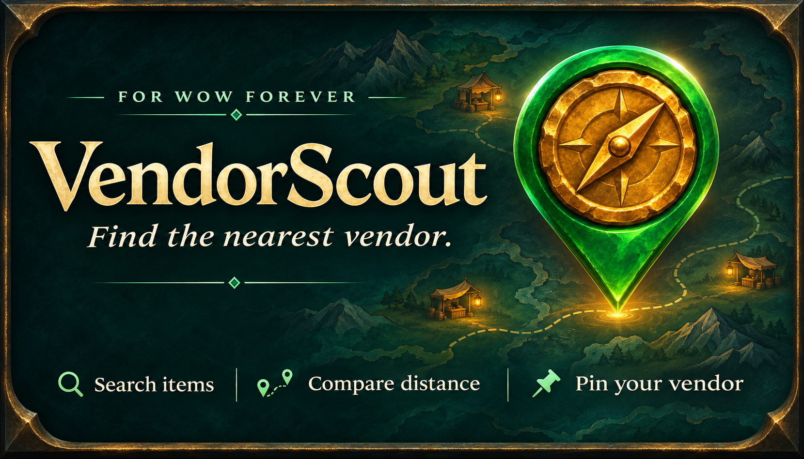

# VendorScout for WoW Forever

Find an item. See who sells it. Go to the nearest known vendor.

VendorScout is a vendor and item search addon for **WoW Forever 1.60.1**. Search from a standalone window or a movable panel beside the world map. Both windows share your search, filters and selection, with the nearest measurable result at the top.

## What's new in 1.1.0

- **12 focused categories plus All:** consumables, food & drink, potions & elixirs, bandages, bags, materials & tools, spell reagents, ammunition, recipes, gear, weapons and armor.
- **12 profession filters:** Alchemy, Blacksmithing, Enchanting, Engineering, Leatherworking, Tailoring, Cooking, First Aid, Fishing, Mining, Herbalism and Skinning.
- **English and Norwegian search keywords:** find common supplies using either language, independently of the interface language.
- **Item tooltips in both windows:** hover an item in the standalone details, or choose a vendor and click **Items** in the map panel. If the client has not cached an item yet, its database name and vendor notes remain available while details load.
- Shared dropdown filters and **Reset filters**, with the same dark panels and green accents.

## Find what you need

Open VendorScout with **`/vs`** or the minimap button. Type an item name, vendor name, item ID or item link. Choose a category and profession to narrow the results; both filters apply together.

| Try this | Find |
| --- | --- |
| `water` or `vann` | Water sold by vendors |
| `tailoring thread` or `skredder tråd` | Thread used by Tailoring |
| `bag` or `veske` | Bags |
| `recipe` or `oppskrift` | Vendor recipes |
| `159` | Refreshing Spring Water by exact item ID |

Common keyword support is not a translation of every item name. English item names remain searchable; source-provided translations follow your client language. The **EN/NO** button changes the interface language.

## Search beside the map

Open the world map or use **`/vs map`**. Drag the separate search panel to the position you prefer; its placement is saved. The small Vendors control inside the map toggles the panel without resizing the map.

Click a result to mark its known location. In the standalone window, use **Show on map**. Small coin icons show matching vendors and the selected location pulses. The nearest match is selected when you submit a search; each login or reload starts with **no vendor selected and no vendor pins**.

- **This map / Everywhere** changes the search area.
- **My faction** is enabled by default.
- **Clear pin** removes the selection and all VendorScout pins in both windows.
- The **× beside the search field** clears the shared query.
- **Reset filters** resets category and profession while keeping your query, faction and map scope.
- **Items** in the map panel opens the selected vendor's matching items for hover tooltips.

## Nearest first

Results use your character's current position and each vendor's nearest known spawn. Distances and ordering refresh every two seconds while a search window is visible. Results with measurable distances come first; other continents and unknown positions follow.

Distances are straight-line yards, not walking routes or travel times. Reputation, stock, level, seasonal access and faction restrictions can still affect purchases. Unknown coordinates stay unknown and never receive invented pins.

## Included database

**3,940 items · 1,151 vendors · 18,010 item–vendor relationships** from the pinned NorgannonDB snapshot generated on **22 November 2026**. The base profile contains 1,210 locations, with 1,186 usable map positions; 39 vendors have no mapped location. Faction-specific locations are included.

Profession filters use the snapshot's recipe and reagent relationships, including Forever-specific skill assignments, plus known tool and gathering-material metadata. Items without a known profession relationship may appear under All professions only.

This is the complete vendor extract of that community snapshot, not a guarantee that every current Forever vendor or item is documented. Visiting a merchant records the items and stock you actually see for your current character. These observations are local history, not live stock tracking, and are never uploaded automatically.

**No additional addon or internet connection is required in game.**

## Install and use

Download the **Forever install ZIP**, then put its `VendorScout` folder in:

`World of Warcraft/_forever_/Interface/AddOns/`

The final path must end in `Interface/AddOns/VendorScout/VendorScout.toc`, without a second nested VendorScout folder. Enable the addon and reload or restart the client after updating. Use `/vs debug` to confirm version **1.1.0**.

| Command | Action |
| --- | --- |
| `/vs` | Open or close the standalone search |
| `/vs water` | Search directly |
| `/vs map` | Open map search |
| `/vs clear` | Clear the selected vendor and pins |
| `/vs reset` | Reset window position and scale |
| `/vs minimap` | Toggle the minimap button |
| `/vs debug` | Show version and database diagnostics |

For a bug report, include the addon version, search text, active filters and any Lua error. [Report an issue](https://github.com/MrKawashima/VendorScout/issues) · [Source and releases](https://github.com/MrKawashima/VendorScout) · [NorgannonDB source](https://github.com/zmarotrix/NorgannonDB/tree/c4c4f81267f8ab91237cb167bb6bc821826a8550).

VendorScout and its bundled source are distributed under **GPL-3.0**. Upstream notices and a reproducible source archive are included with every release.

## Development

Python 3.11+ and `lupa==2.8` provide an actual Lua 5.1 interpreter for tests. Pillow is needed only for the schematic layout previews.

```powershell
python -m pip install -r requirements-dev.txt
python -m unittest discover -s tests -v
python tools/build_database.py
python tools/preview.py preview
python tools/package.py dist
```

The source ZIP includes `source-data/NorgannonDB/`: all consumed source files, their original notices and the pinned snapshot marker. `tools/build_database.py` verifies the hashes in `database-manifest.json` before executing this trusted snapshot. Database output is deterministic. An external git checkout can also be passed as the first argument. Updating the snapshot requires reviewing the schema, changing `SOURCE_COMMIT`, updating expected coverage and revalidating both factions.

The source audit tests use the bundled snapshot, or `../NorgannonDB` when working with a checkout. They compare every relationship and generated coordinate to the upstream data, not only a few sample items. Tests use an explicit WoW API/UI simulation; they do not establish in-game compatibility.

The current build passed 73 tests, including bilingual keyword equivalence, all recipe/reagent profession links, shared dropdown filters and item tooltip fallback/loading in both windows. Lua syntax, missing item-cache behavior, exact IDs/links, faction-specific spawns, pagination, map scope, pin limits, combat restrictions, vendor observations, movement-based reordering, and absent/secret coordinates are covered. The UI simulation models multiple anchors, strata, frame levels, pointer targeting, focus, typing and the caret. A regression test reproduces the old input interception by the HIGH map border. Floating-window tests check placement outside the map, unchanged canvas anchors, dragging, saved positions, scale, screen clamping and close/reopen behavior. Additional tests exercise both search fields and both Clear actions, shared selection, automatic native map search and minimap navigation. A local inspection also checked the relevant APIs against Blizzard UI source from Gethe/wow-ui-source's `forever` branch at `734f065329cff4992835b01a84f210a297db91b6`. When that checkout is present at `../wow-ui-source`, integration tests exercise its MapCanvas data-provider base; otherwise they use the included explicit API simulation.

## In-game verification checklist

The beta UI was tested in game by the project owner. Automated checks below use simulated APIs; repeat this checklist when client or map behavior changes.

1. Install in Forever, enable Lua errors, log in as Alliance and Horde.
2. Search `159` from two different positions; verify the first vendor changes appropriately and distances change while moving.
3. Open the world map, search in the map panel, click a result and verify the pulsing pin aligns with the NPC's known location. Test zone/continent changes, zooming and minimized/maximized maps.
4. Test a vendor without coordinates, an item requiring reputation, and a limited-stock item. Unknown data must stay unknown.
5. Open a merchant with a previously unrecorded item, reload, and verify the timestamped observation remains searchable.
6. Compare `vann` with `water` and `skredder tråd` with `tailoring thread`; combine category and profession filters in both windows, reset them and clear pins. Hover cached and uncached items, including the map panel's Items list.
7. Verify combat blocks map opening without Lua errors; verify Escape, minimap dragging and the EN/NO controls.

Preview PNGs generated by the tool are schematic renders of the actual Lua frame tree using substitute fonts and simulated distances. They are not in-game screenshots.

## Source layout

- `VendorScout/Data.lua`, `Locales.lua`: generated data, ready for offline use.
- `Filters.lua`: bilingual vocabulary, categories and professions.
- `Search.lua`: search, coordinate conversion and ranking.
- `UI.lua`: standalone window, details, language and minimap control.
- `Map.lua`, `Pins.xml`: map search, data provider and owned map pins.
- `Merchant.lua`: positive observations; never deletes inventory based on a filtered merchant window.
- `Core.lua`: lifecycle, debouncing, refresh and slash commands.
- `tools/`, `tests/`, `database-manifest.json`: reproducible build and validation.

GPL-3.0. Full license and upstream notices are included with the addon and source snapshot. No network calls, purchases, automatic movement or public publishing occur in the addon.
